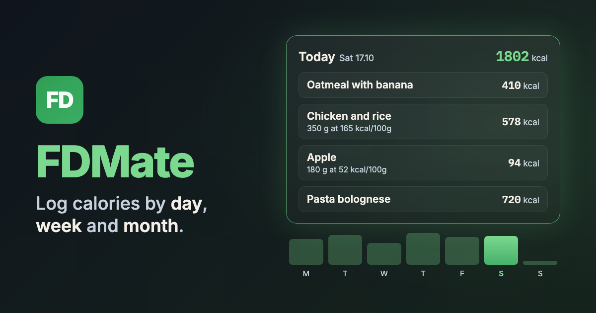

# 🥗 FDMate

  

A manual calorie tracker built with React, Vite and Firebase.

🔗 [faleonfall.github.io/FDMate](https://faleonfall.github.io/FDMate/)

## ✍️ Logging food

- **Per 100 g:** enter the calories per 100 g and the grams eaten
- **Total:** enter the calories directly, as plain arithmetic like `56 + 45 * 2`, or negative like `-200` for burned calories
- **Data menu:** export a range of days as JSON, or import a file to restore them
